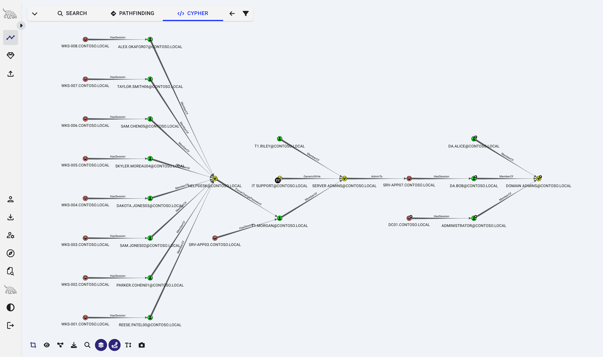
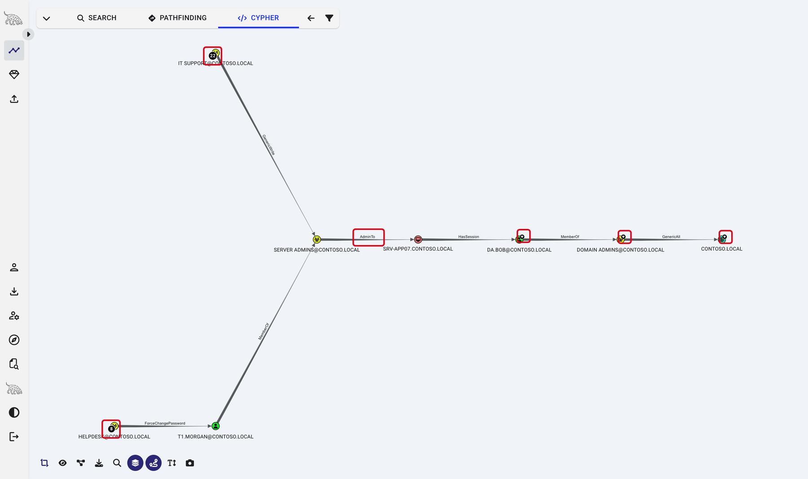
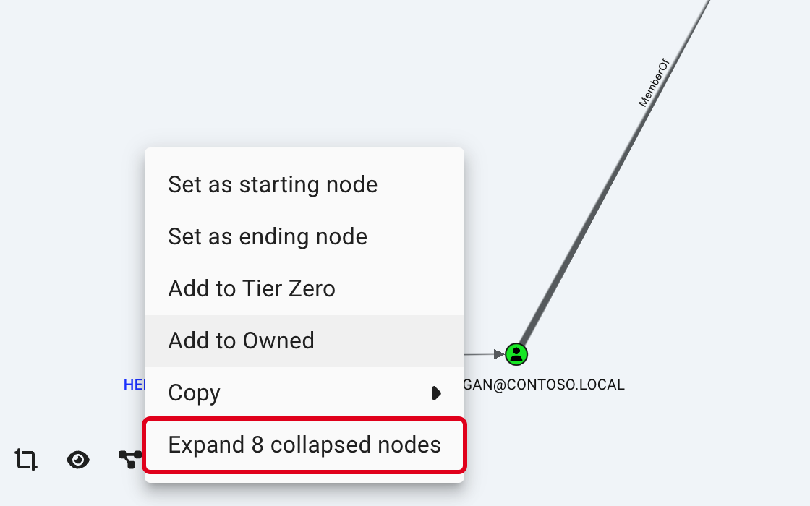
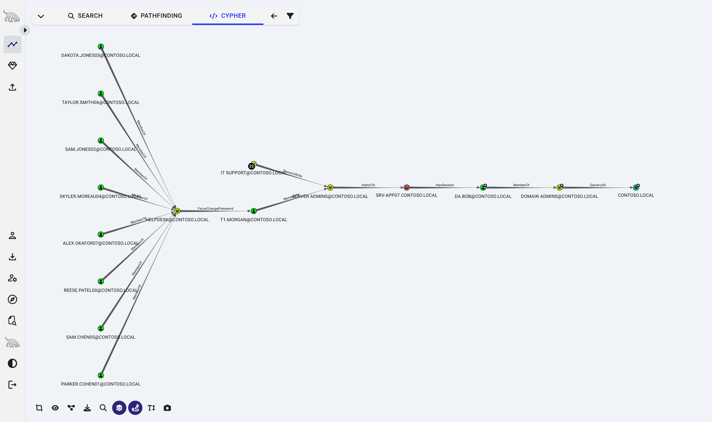
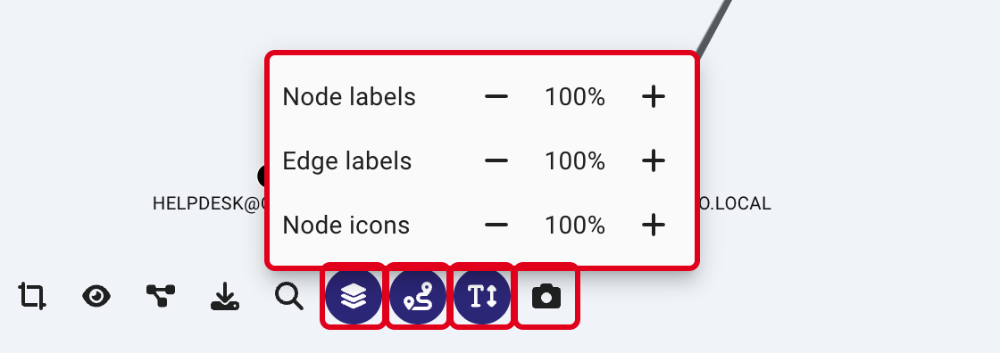
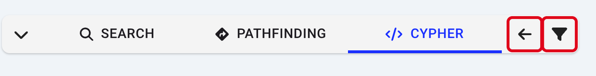
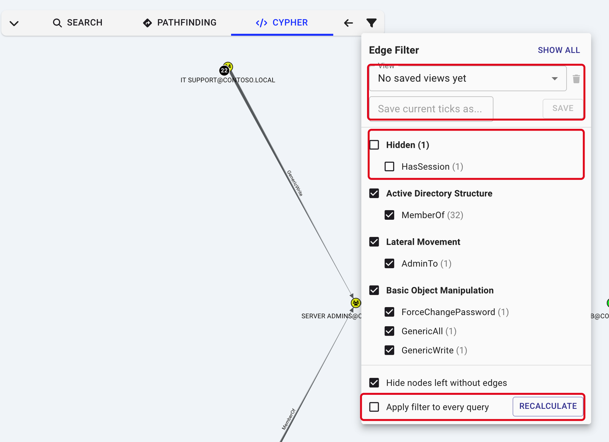
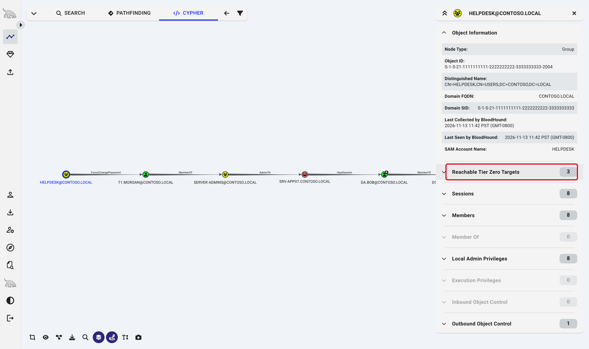
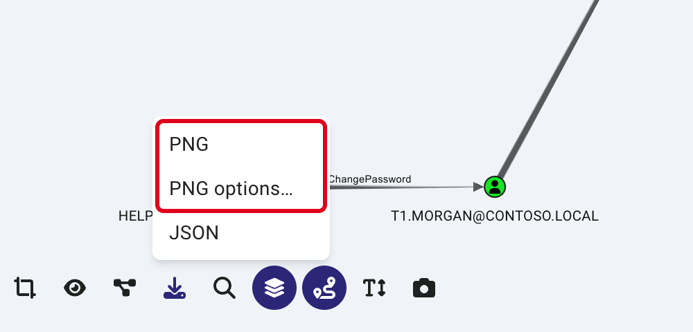
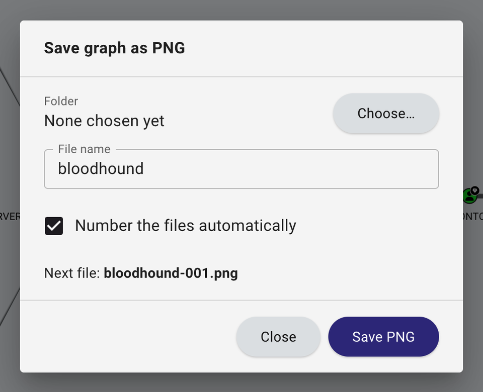

# BloodHound CE with a Legacy-style Explore view

A fork of [BloodHound Community Edition](https://github.com/SpecterOps/BloodHound) (based on 9.8.0) that makes the Explore graph look and work much more like BloodHound Legacy: left-to-right graphs that fit on one screen, Legacy-style collapsed nodes with count bubbles, an edge filter with saved views that can apply to every query, Reachable Tier Zero Targets in the node panel, label and icon size controls, Exclude from query, and PNG export straight into a folder.

Only the UI changes. Ingest, post-processing, analysis, Tier Zero tagging, the API, storage and CE's built-in Saved Queries are standard CE, so existing databases open in it as they are, whether CE stores its graph in Neo4j or PostgreSQL.

All work is on the `legacy-view` branch. The screenshots below use a made-up `CONTOSO.LOCAL` demo domain, and red boxes mark what is new. Implementation notes and server settings for large queries are in [LEGACY_VIEW.md](LEGACY_VIEW.md).

## Why this fork

BloodHound CE is where data gets collected and where detailed path analysis happens, but on a large environment its Explore graph is hard to read. The layout packs everything tightly, nodes and labels shrink as the graph grows, and a real attack path soon turns into a wall of tiny icons that is hard to reason about and worse to put in a report.

BloodHound Legacy draws the same kind of data far more legibly: left to right, spread out, readable at full zoom-out, with leaf nodes folded into count bubbles. This fork brings that view into CE itself, so you keep everything CE knows (its node kinds, edges, Tier Zero tagging and pathfinding) and get Legacy's readable layout and report-ready screenshots without switching tools.

## Getting it

The [Releases](https://github.com/edtrud385/BloodHound/releases) page has ready-made Docker images (load one with `docker load -i` and start it with the `docker-compose.yml` attached to the release) and server binaries for Linux, macOS and Windows. They are built by `.github/workflows/legacy-view-release.yml`.

To build it yourself, build the normal CE image from the `legacy-view` branch and use it in place of `specterops/bloodhound` in your compose file:

```bash
git clone -b legacy-view https://github.com/edtrud385/BloodHound.git
cd BloodHound
docker build -f dockerfiles/bloodhound.Dockerfile -t bloodhound-legacy-view .
```

Pass `--build-arg INCLUDE_COLLECTORS=no` to leave the SharpHound and AzureHound downloads out of the image (Download Collectors is then empty). Antivirus and cloud-storage scanners often flag the SharpHound zip, so this makes a saved image easier to share.

This UI expects a CE 9.x server. Against CE 8.x graphs still draw, but the node panel and right-click menu stay empty because 8.x has no `/api/v2/nodes/{id}` endpoint.

## Legacy-style layout

Graphs are laid out left to right and stretched to fill the screen, like Legacy. Labels stay readable at full zoom-out and grow smoothly as you zoom in, names up to 40 characters are shown in full (CE cuts them at 20), and edges taper from the source end to the target end with the label drawn along the line.



## Collapsed nodes, Tier Zero badges and edge labels

- **Count bubbles:** a node with 5 or more leaf neighbours folds them away and shows a black count bubble. Hovering it says what is folded in (for example "8 Users folded in (MemberOf)").
- **Tier Zero badges** are bigger, so they can be seen without zooming in.
- **Edge labels** sit along the edge, never upside down, with no white box behind them.
- The graph has a faint grey background, so exported PNGs don't disappear on a white page.

In the demo domain, HELPDESK can reset the password of T1.MORGAN (ForceChangePassword). T1.MORGAN is a member of SERVER ADMINS, which is local admin on SRV-APP07, where domain admin DA.BOB has a session. The bubbles hide the 8 HELPDESK members and the 22 IT SUPPORT members, so the whole path from any helpdesk account to Domain Admins fits on one screen:



## Expand and collapse

Double-click a node with a count bubble, or right-click → **Expand N collapsed nodes** (at the bottom of the menu). The layout re-runs and the leaves drop into their own column. Right-click → **Collapse N nodes** folds them back.





## Graph controls

- **Layers button:** turns node collapsing off and on.
- **Route button:** turns path highlighting off and on. CE dims everything that is not on a path through the selected node; CE has the setting but no button for it.
- **T button:** makes node labels, edge labels and node icons bigger or smaller, each on its own (like Legacy's label size settings). Your sizes are remembered in your browser.
- **Camera button:** copies the graph to the clipboard as an image, ready to paste into a report or chat.



## Back button and Edge Filter

**←** steps back to the previous graph. The filter button opens a Legacy-style **Edge Filter**:

- It lists only the edge types in the current graph, with counts. Unticking a type hides those edges at once.
- Unticked types move to a **Hidden** group at the top, so they are easy to tick back.
- The current ticks can be saved as named **views**.
- **Apply filter to every query** removes the unticked types from the Cypher query and re-runs it, like Legacy, so paths around them show up. **Recalculate** does the same once for the current query.





## Exclude from query

Right-click a node → **Exclude from query** takes that object out of every Cypher query and re-runs the current one, so shortest paths go around it. The **Excluded (n)** button on the Cypher tab lists what is excluded, with an × to bring each one back and **Clear all**. The list is kept in your browser per BloodHound instance.

## Reachable Tier Zero Targets

Legacy's **Reachable High Value Targets** is back in the node panel, named for CE's Tier Zero. The count is every Tier Zero object the selected node can reach. Clicking it draws those paths, and the query shows on the Cypher tab so it can be edited. Expect higher counts than Legacy, because CE tags far more objects as Tier Zero.



## Save as PNG

**Export > PNG** saves the graph exactly as it is on screen. **PNG options…** lets you pick a folder once, set the file name, and number the files automatically (bloodhound-001.png, bloodhound-002.png, and so on), without ever overwriting a file. Picking a folder needs Chrome or Edge. In Firefox each PNG is a download with the numbered name; to choose where it goes, turn on *Settings > Downloads > Always ask you where to save files*.





## Smaller changes and fixes

- Saved Queries open expanded when you switch to the Cypher tab.
- Icons no longer vanish on hover or selection.
- Nodes no longer get stuck to the mouse after a quick click.
- Parallel edges between the same two nodes each get their own curve and label.

## Building for development

```bash
node .yarn/releases/yarn-4.13.0.cjs install
cd cmd/ui && node ../../.yarn/releases/yarn-4.13.0.cjs dev   # proxies the API to localhost:8080
```

---

<p align="center">
    <picture>
        
    </picture>
</p>

<hr />

BloodHound is a monolithic web application composed of an embedded React frontend with [Sigma.js](https://www.sigmajs.org/) and a [Go](https://go.dev/) based REST API backend. It is deployed with a [Postgresql](https://www.postgresql.org/) application database and a [Neo4j](https://neo4j.com/) graph database, and is fed by the [SharpHound](https://github.com/SpecterOps/SharpHound) and [AzureHound](https://github.com/SpecterOps/AzureHound) data collectors.

BloodHound leverages graph theory to reveal hidden and often unintended relationships across identity and access management systems. Powered by [OpenGraph](https://specterops.io/opengraph/?utm_campaign=Direct_DemoRequest_2025_09_01_GitHub&utm_medium=DemoRequest&utm_source=Direct&Latest_Campaign=701Uw00000X36PF), BloodHound now supports comprehensive analysis beyond Active Directory and Azure environments, enabling users to map complex privilege relationships across [diverse identity platforms](https://bloodhound.specterops.io/opengraph/library). Attackers can utilize BloodHound to rapidly discover sophisticated attack paths otherwise impossible to identify manually, while defenders can proactively identify and mitigate these risks. Both red and blue teams benefit from BloodHound's expanded capabilities, gaining deeper insights into identity and privilege structures across their entire security landscape.

BloodHound CE is created and maintained by the [SpecterOps](https://specterops.io/?utm_campaign=Direct_DemoRequest_2025_09_01_GitHub&utm_medium=DemoRequest&utm_source=Direct&Latest_Campaign=701Uw00000X36PF) team who also brought you [BloodHound Enterprise](https://specterops.io/bloodhound-overview/?utm_campaign=Direct_DemoRequest_2025_09_01_GitHub&utm_medium=DemoRequest&utm_source=Direct&Latest_Campaign=701Uw00000X36PF). The original BloodHound was created by [@\_wald0](https://www.twitter.com/_wald0), [@CptJesus](https://twitter.com/CptJesus), and [@harmj0y](https://twitter.com/harmj0y).

## Running BloodHound Community Edition
Please refer to the [Quickstart Guide for BloodHound Community Edition](https://bloodhound.specterops.io/get-started/quickstart/community-edition-quickstart), which is part of the [BloodHound documentation](https://bloodhound.specterops.io).

## Useful Links

- [BloodHound Documentation](https://bloodhound.specterops.io/)
- [BloodHound Community Edition Quickstart Guide](https://bloodhound.specterops.io/get-started/quickstart/community-edition-quickstart)
- [BloodHound Slack](https://slack.specterops.io)
- [OpenGraph Documentation](https://bloodhound.specterops.io/opengraph/overview)
- [Wiki](https://github.com/SpecterOps/BloodHound/wiki)
- [Docker Compose Example](./examples/docker-compose/README.md)
- [Developer Quick Start Guide](https://github.com/SpecterOps/BloodHound/wiki/Development)
- [Contributing Guide](https://github.com/SpecterOps/BloodHound/wiki/Contributing)
- [Contributors](./CONTRIBUTORS.md)

## Contact

Please check out the [Contact page](https://github.com/SpecterOps/BloodHound/wiki/Contact) in our wiki for details on how to reach out with questions and suggestions.

## Licensing

```
Copyright 2025 Specter Ops, Inc.

Licensed under the Apache License, Version 2.0
you may not use this file except in compliance with the License.
You may obtain a copy of the License at

    http://www.apache.org/licenses/LICENSE-2.0

Unless required by applicable law or agreed to in writing, software
distributed under the License is distributed on an "AS IS" BASIS,
WITHOUT WARRANTIES OR CONDITIONS OF ANY KIND, either express or implied.
See the License for the specific language governing permissions and
limitations under the License.
```

Unless otherwise annotated by a lower-level LICENSE file or license header, all files in this repository are released
under the `Apache-2.0` license. A full copy of the license may be found in the top-level [LICENSE](LICENSE) file.
